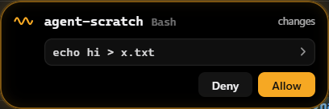

# Cay

**A Dynamic Island for Windows 11.** A small pill sits at the top centre of your screen. Hover the top edge and it
opens into a panel; when something happens (a song changes, the volume moves, a Claude Code session finishes or needs
you), it grows on its own for a moment and shrinks back. It never takes focus from the app you're in, and while
collapsed it doesn't block a single click.

<p>
  
  &nbsp;
  
</p>
<p>
  
</p>

> **Status:** v0.2 is being prepared. Cay was called TopBar until November 2026. Built for Windows 11 only.

## What it does

- **Clock and running apps.** Hover the top edge: the panel lists your open windows with their icons; click one to
  switch to it.
- **Now playing.** Album art, title, progress and controls for whatever is playing (Spotify, browsers, anything that
  uses Windows' media controls). The island takes its colours from the album art.
- **Live activities.** Volume, brightness, Bluetooth headphones connecting (with battery), charger plugged in or
  low battery, Caps Lock, and new screenshots, which you can drag straight out of the island into a chat or folder.
- **Coding agent sessions** (optional): Claude Code, Codex and OpenCode. Cay shows when a session in your terminal or
  editor is working, when it's done and when it needs your input, and lets you allow or deny its permission requests
  from the island; click to jump to its window. Each agent is connected separately from the tray.
- **Claude agent** (optional). Press **Win+Alt+A**, type a task, pick a folder and walk away. Cay runs Claude Code in
  the background, shows progress in the island, and works like Claude Code's own permission modes: **Auto** by default (Claude Code
  judges each step; questions and plans still come to you), or **Ask**, **Accept edits** and **Plan**, switched from
  a chip on the run. Claude can also look at windows and click and type for you. A task or routine can run on
  **OpenCode** or **Codex** instead (picked in the task form), with the same four modes mapped onto each agent's own
  settings (see below).
  **Win+Alt+Escape** stops every run. Tasks can be saved as routines that run on a schedule while Cay is running.

## Install

Download `Cay_<version>_x64-setup.exe` from [Releases](https://github.com/Stanwukong/wpill/releases) and run it. It installs for
your user only (no admin) into `%LOCALAPPDATA%\Cay`, and adds a tray icon with **Launch at startup** and **Quit Cay**.

v0.2 isn't code-signed yet (signing is planned from v0.3), so Windows SmartScreen will say "Windows protected your PC"
and list the publisher as unknown. Check your download first (below), then click **More info** → **Run anyway**.

**Check your download.** Each release lists the installer's SHA-256 checksum. In PowerShell:

```powershell
Get-FileHash .\Cay_0.2.0_x64-setup.exe -Algorithm SHA256
```

The hash must match the one on the release page exactly. If it doesn't, delete the file.

**Coming from TopBar?** Quit TopBar from its tray, then install Cay. On first start Cay copies TopBar's settings,
routines and agent history, and moves the startup entry if you had it on. If you'd connected Claude Code, click
**Connect Claude Code…** in Cay's tray once: it replaces TopBar's hooks. Then uninstall TopBar from Settings → Apps.

## What it needs

- Windows 11 (64-bit). The WebView2 runtime it uses is part of Windows 11.
- For the Claude features: [Claude Code](https://docs.claude.com/en/docs/claude-code) installed and signed in
  (tested with 2.1.123 to 2.1.314). Git Bash is used for the hooks when it's installed; PowerShell otherwise.
- Agent runs use your own Claude Code account and count against its usage and limits.
- Optional, for other agents:
  - **Codex** sessions: Codex CLI 0.166 or later. Codex runs: also `npm install -g @agentclientprotocol/codex-acp`
    (Cay starts it with Node). Both use your Codex sign-in and count against it.
  - **OpenCode** sessions and runs: OpenCode 1.19.5 or later (`npm install -g opencode-ai`). It brings its own models,
    including free ones, or uses any provider you set up in OpenCode.
  - **Local models** (through Goose with Ollama) are planned. Be realistic about hardware: agent work needs a
    model around 30B parameters, which wants about 32 GB of RAM or a 24 GB GPU. 16 GB runs smaller models slowly, and
    8 GB isn't enough.

## What it touches, and privacy

Cay is local. **It makes no network requests of its own**: no telemetry, no update checks, no accounts. The only traffic
is Claude Code's own, to Anthropic, when *you* start an agent run (and a link you approve Claude opening in your
browser).

| Where | What | When |
|---|---|---|
| `%APPDATA%\io.github.stanwukong.cay\settings.json` | Activity switches and agent settings (edit by hand) | Read at start |
| `%APPDATA%\io.github.stanwukong.cay\routines.json` | Your saved routines | When you save one |
| `%APPDATA%\io.github.stanwukong.cay\agent\*.jsonl` | An audit trail of each agent run: what was asked, each tool call, your decisions. Typed text is reduced to its length; screenshots are never stored | During runs |
| `%APPDATA%\io.github.stanwukong.cay\agent\runs\` | Per-run config for Claude Code | Deleted when the run's process ends |
| `~/.codex/hooks.json` | Eight hook entries that run `cay.exe hook --agent codex` | **Only when you click Connect Codex…**, after a dialog that shows them. Backed up first; Disconnect removes only Cay's entries. Codex asks you to trust them once with `/hooks` |
| `~/.config/opencode/plugins/cay.js` | A small plugin that passes OpenCode's session events to Cay and your answers back | **Only when you click Connect OpenCode…**; Disconnect deletes it. Your `opencode.json` is never changed |
| `%LOCALAPPDATA%\io.github.stanwukong.cay\` | WebView2's cache | Always |
| `HKCU\…\CurrentVersion\Run`, value `Cay` | Launch at startup | Only when you tick it |
| `~/.claude/settings.json` | Seven hook entries that run `cay.exe hook` | **Only when you click Connect Claude Code…**, after a dialog that shows the exact entries. Backed up first; Disconnect removes only Cay's entries |

- **Hooks send almost nothing.** The hook forwarder passes five fields (the event, session id, folder, notification
  type and session source), a timestamp and its process chain to Cay, over a pipe only your user can open. Your prompts, Claude's answers and tool output
  never reach Cay.
- **Screenshots stay with Claude Code.** When you approve a screenshot in an agent run, Claude Code keeps the image in
  its own session transcript under `~/.claude/projects`, outside Cay's control. Cay never captures itself or a
  password field's contents.

## Agent runs get the permission mode you pick, never more

- Runs use Claude Code's own permission modes: **Auto** (the default: Claude Code's classifier approves everyday steps
  and blocks risky ones), **Ask** (every step Claude Code would ask about waits for you in the island), **Accept
  edits** and **Plan**. You pick one per task or routine and can switch a running task from its chip. Every change is
  in the audit trail. Cay never uses `bypassPermissions` or `--dangerously-skip-permissions`, never changes your Claude
  Code settings for a run, and never changes the mode of a session you run in a terminal.
- Whatever Claude Code asks about comes to the island, and only your click answers it; questions and plans come to you
  in every mode. Outside Auto, each look at the screen and each desktop action is approved on its own, and clicks and
  typing are never remembered "for this run". In every mode, any key you press or mouse move you make stops an action
  immediately, and the screen's edge glows while Claude looks or acts.
- An unanswered approval is denied after 10 minutes. Scheduled routines can wait for you while you're away.
- Everything a run starts lives in a Windows Job Object: Stop, Win+Alt+Escape or quitting Cay ends the whole process
  tree.

### Runs on other agents

OpenCode and Codex get the same four modes, mapped to each agent's nearest setting. Cay never uses an agent's
"approve everything" setting, and gives a run its rules through that run's environment, so your own config files are
never changed.

| Cay mode | Claude Code | Codex | OpenCode |
|---|---|---|---|
| **Auto** | Claude Code's classifier judges each step | Codex's own "Auto review" asks only about steps it judges unsafe | Edits in the folder and a fixed list of read-only, build and test commands run; any other command, anything outside the folder and web fetches ask |
| **Accept edits** | Edits run, the rest asks | Edits in the workspace run; writing outside it or going online asks | Edits run, shell commands ask |
| **Ask** | Every step Claude Code would ask about | Read-only: every edit and network use asks | Every edit, command and fetch asks |
| **Plan** | Plan mode | Read-only, planning first | OpenCode's read-only `plan` agent |

What differs from Claude Code runs:
- **"Auto" protects less on OpenCode**: it's a list of allowed commands, not a reviewer. Pick Ask or Accept edits there
  when that matters.
- **Desktop actions follow the mode** for every agent, but only Claude Code's Auto has a classifier judging them. Gmail
  always asks, and after a run reads mail its desktop actions ask again, whatever the agent.
- **In Ask and Plan, Cay checks the agent really asked**: a run that edits or runs a command without asking is stopped.
- **A mode change takes effect from your next message**, not mid-turn.
- **Cay's turn and budget limits don't reach these agents**; use the agent's own limits. A run that sends nothing for 10
  minutes is stopped.

## Build from source

```powershell
.\scripts\check-env.ps1     # Rust (MSVC), VS Build Tools, Node, pnpm, WebView2
pnpm install
pnpm tauri dev              # run it
pnpm tauri build            # release build and NSIS installer
```

Stack: Tauri 2, Rust (`windows` crate), React + TypeScript + Vite, Framer Motion. [CLAUDE.md](CLAUDE.md) explains the
architecture and its Windows gotchas, [PLAN.md](PLAN.md) the roadmap, and [CASESTUDY.md](CASESTUDY.md) every decision
along the way.

## Not affiliated with Anthropic, OpenAI or OpenCode

Cay is an independent open-source project built on [Claude Code](https://docs.claude.com/en/docs/claude-code), and
optionally works with Codex and OpenCode. It is not made, endorsed or supported by Anthropic, OpenAI or the OpenCode
project. Claude and Claude Code are trademarks of Anthropic, PBC; Codex is a trademark of OpenAI.

## License

[MIT](LICENSE) © 2026 Oluwafemi S.E. Ajanaku
